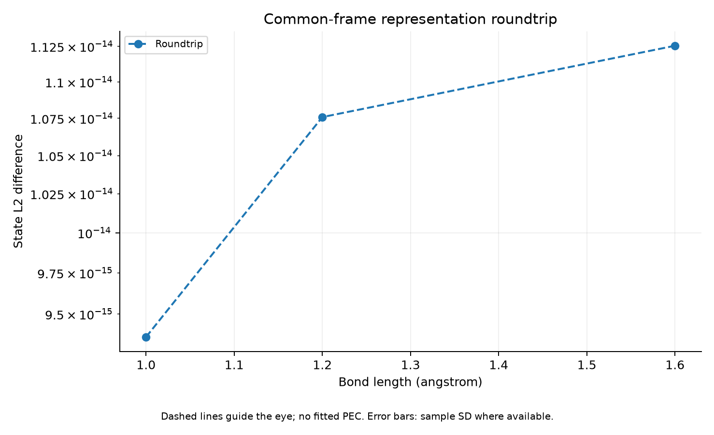

# Common-Frame Representation for a Meta Pilot

작성일: 2026-11-04. 상태: 표현 후보의 수치 검증 완료. Meta 모델 학습과 일반화 검증은 미실행.

## 기준 frame

Anchor는 초기 단일 검증 지점인 N₂ 1.2 Å다. 이후 Meta split에서 반드시 training geometry로 포함한다. Unseen geometry의 optimized parameters로 frame이나 통계를 만들지 않는다. Target HF orbitals와 anchor training HF orbitals의 overlap은 inference에서도 계산 가능한 입력이다.

Source R에서 anchor로 가는 overlap O의 occupied/virtual diagonal block에서 polar(O†)를 구해 G(R→anchor)를 만든다. 16 orbitals, (5,5)의 현재 RHF 설정에 맞는 block 분할이다. Geometry 간 유한 active spaces의 overlap은 unitary가 아니므로 이 G는 정확한 물리적 식별이 아니라 고정한 approximate transport 선택이다.

## Operator frame 변환

내부 orbital rotations를 U→GU, final rotation을 F→GFG†로 변환하고 J는 유지한다. 이는 전체 operator의 Γ(G) conjugation이다. G가 HF occupied/virtual partition을 보존하므로 상태는 Γ(G)|ψ>와 global phase까지 일치한다. 현재 real RHF block rotations에서는 두 spin의 HF 위상이 상쇄된다. 원래 frame으로 되돌릴 때 G†를 사용한다.

Warm-start output transport의 F→GF와 state 수준에서 global phase까지 같은 효과를 내지만 parameter encoding은 다르다. Meta 표현에는 모든 내부 회전도 공통 mode 좌표로 나타내는 위 conjugation convention을 사용한다. 이 구분 없이 두 표현의 raw features를 섞지 않는다.

## Features와 decode

각 layer에서:

1. 내부 U의 각 column에서 절댓값이 가장 큰 성분의 phase를 제거한다. 이 diagonal column phase는 density J와 commute하여 layer operator를 보존한다.
2. U의 real/imag matrix entries를 저장한다.
3. 고정된 AA/AB interaction list 순서의 J에 대해 cos(J), sin(J)를 저장한다.

마지막으로 F의 real/imag matrix entries를 저장한다. Final F의 임의 column phase를 제거하지 않는다. Final rotation은 실제 correlated state에 작용하므로 내부 U와 같은 gauge 처리를 해서는 안 된다.

현재 1-layer, 16 orbitals에서는 1062 features다. Raw library parameters 531개보다 큰 redundant embedding이며 low-dimensional model이 자동으로 쉬워지는 것은 아니다. Matrix entries는 logarithm branch를 피하고 sin/cos는 검증된 J periodicity를 반영한다.

Decode는 각 예측 complex matrix를 nearest unitary polar로 투영하고 J를 atan2(sin,cos)로 복원한다. Singular matrix나 0인 angle pair는 오류로 처리한다. Prediction의 projection은 물리적 상태를 바꿀 수 있으므로 실제 SQD energy로 검증해야 한다. Feature MSE를 최종 성능으로 사용하지 않는다.

## 수치 증거

Nontrivial small-system tests에서 column phase/J periodicity에 대한 feature 일치와 state 일치, encode/decode, common-frame covariance 및 inverse를 확인했다. 전체 프로젝트 테스트는 14개다.

N₂ 세 구조의 inverse-frame roundtrip state L2 error:

| 거리 (Å) | State L2 error |
| --- | --- |
| 1.0 | 9.36e-15 |
| 1.2 | 1.08e-14 |
| 1.6 | 1.13e-14 |

원본은 results/representation_20261104T065315/report.json이며 features.npz에 세 geometry의 vectors를 저장했다. 최초 output-only embedding draft는 results/representation_20261104T065059에 보존하지만 위 현재 schema의 학습 데이터로 섞지 않는다.

## 남은 한계와 다음 실험

최대 성분 column phase 고정은 tie/최대 index 변화에서 불연속일 수 있다. 내부 permutation/축퇴공간 gauge, final global phase, anchor/path 의존성을 모두 제거한 유일 표현은 아니다. 세 geometry로 effective dimension이나 smooth learnability를 입증하지 못한다.

다음 Meta pilot은 이 세 geometry를 development training 후보로 명시하고, 새로운 interpolation geometry를 validation/evaluation용으로 분리해야 한다. 모델 복잡도와 preprocessing은 training/validation에만 맞추고 final test를 별도로 유지한다. 첫 후보는 단순 affine/ridge 모델이며 실제 모델 선택은 validation SQD energy와 학습 overhead를 기준으로 한다. 이 문서는 구현된 표현과 검증을 설명하며 아직 해당 모델을 학습한 것은 아니다.

```bash
PYTHONPATH=src PYTHONDONTWRITEBYTECODE=1 OPENBLAS_NUM_THREADS=1 OMP_NUM_THREADS=1 .venv/bin/python scripts/build_representation.py
```

기존 independent best archives가 필요한 로컬 검증 명령이다.

## 복원 오차 그래프


