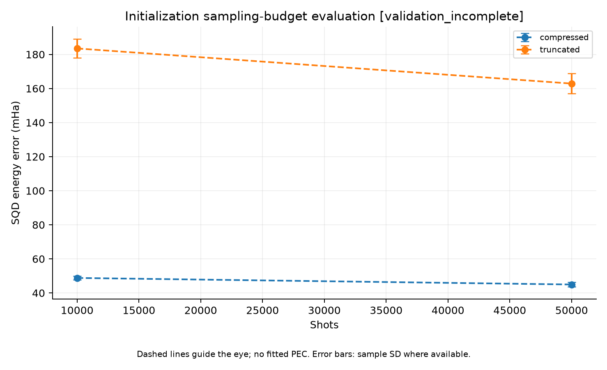

# Single-Geometry Initialization Comparison

실행일: 2026-11-03. Phase 1 후속 진단. **압축 초기화는 SQD 에너지를 개선했지만 압축 optimizer가 미수렴이므로 검증 완료로 판정하지 않는다.** Phase 2 sweep과 Meta 학습은 실행하지 않았다.

## 방법과 통제 조건

N₂ 1.2 Å, 6-31G, frozen core 2, active (10e,16o), 1-layer spin-balanced LUCJ, 531 parameters, 동일한 locality mask와 t₁ final rotation을 유지했다. 기존 단순 truncation과 library의 single-stage compressed double factorization을 비교했다. 압축은 0.5*||t₂_reconstructed−t₂_CCSD||²를 최소화하며 SQD 에너지를 직접 최적화하지 않는다. AA/AB mask 합집합에서 압축하고 각 spin mask를 나중에 적용하는 library 절차를 따른다. Regularization과 multi-stage는 사용하지 않았다.

설정은 results/initialization_20261103T065552/source_snapshot/configs/initialization_comparison.json에 저장했다. Seeds는 12345, 23456, 34567이고 shots는 10,000 또는 50,000이다. SQD는 200 samples/batch, 3 batches, 최대 2 iterations로 동일하다. 비교 방법 모두 solver tolerance=1e-13, 최대 200 cycles로 강화했다. 목표 정확도를 달성한 값만 골라내지 않고 모든 결과를 기록했다.

## SQD 에너지 오차

다음은 refined FCI 대비 오차의 seed 3개 평균 ± 표본 표준편차다. 3회는 탐색적 진단이며 confidence interval이나 일반화 성능을 의미하지 않는다.

| 초기화 | Shots | SQD 오차 (mHa) | 평균 고유 determinant 수 | 부분공간 차원 (seed 순) |
| --- | --- | --- | --- | --- |
| truncated | 10,000 | 183.507 ± 5.599 | 23.0 | 110, 168, 120 |
| truncated | 50,000 | 162.892 ± 5.878 | 45.3 | 484, 483, 506 |
| compressed | 10,000 | 48.817 ± 1.147 | 284.7 | 7304, 7040, 6720 |
| compressed | 50,000 | 44.970 ± 1.268 | 716.7 | 8730, 8170, 9024 |

모든 실행에서 particle-valid shots는 전체 shots와 같고 상태 norm error는 1e-10보다 작았다. 12개 실행의 모든 batch projected residual이 1e-6 Ha 기준을 통과했다. 압축은 sampling support를 넓혔지만 Cartesian-product 공간도 훨씬 커져 대각화 비용이 늘었다. Shots 증가는 관측 support뿐 아니라 고정된 batch 예산에서 선택할 후보의 분포도 바꾸므로, 에너지 차이를 shots만의 보편적인 효과로 해석하지 않는다.

## 압축 수렴과 비용

압축은 10,000 iterations, 10,257 function evaluations 후 반복 한도에 도달했다. Optimizer success=false, gradient norm=6.06e-4다. 합집합 mask의 초기 fitting loss 0.0451820에서 최종 loss 0.0151472로 감소했지만 수렴한 해는 아니다. 이 loss는 spin별 mask 적용 전의 amplitude fitting 진단이며 최종 SQD 에너지나 fidelity가 아니다.

초기화 시간은 truncated 0.003초, compressed 5.328초였다. State preparation은 각각 1.121초와 1.170초였다. 평균 sampling/SQD 시간은 아래와 같다.

| 초기화 | Shots | Sampling 평균 | SQD 평균 |
| --- | --- | --- | --- |
| truncated | 10,000 | 0.144초 | 0.088초 |
| truncated | 50,000 | 0.222초 | 0.300초 |
| compressed | 10,000 | 0.144초 | 0.614초 |
| compressed | 50,000 | 0.228초 | 0.786초 |

전체 실행 108.038초, 프로세스 peak RSS 5305.66 MiB (약 5.18 GiB)다. 이 전체 비용에는 reference 계산과 여러 seed/shot 진단이 포함된다. 압축 초기화와 state 준비는 각 방법당 한 번 수행해 재사용했으며, batch/seed별 별도 초기화 비용을 반복 합산하지 않았다. 전체 timer는 초기 import 이후부터다. 단일 프로세스 peak이며 단계별 peak는 아니다. PySCF OpenMP 미지원 상태에서 BLAS thread 1로 실행했다. 이 비교는 accuracy-matched speedup 실험이 아니며 압축의 비용 절감을 입증하지 않는다.

## 기준 에너지 확인

FCI tolerance를 1e-9에서 1e-11 Ha로 강화했다. Refined FCI total은 -109.09813082054681 Ha, converged=true, eigenvector residual은 2.99e-6 Ha다. 기존 값 대비 변화는 약 -4.99e-11 Ha다. 현재 수십 mHa 차이에 비해 작지만 모든 자릿수의 정확성이나 엄밀한 energy error bound를 증명하지 않는다. Refined FCI 계산은 86.866초, residual 확인은 4.604초였다.

## 실패와 보존된 기록

예비 실행 results/initialization_20261103T065403/report.json에서는 압축이 1,000회 한도에 도달하고 SQD residual도 일부 기준을 초과했다. 후속 설정을 강화한 이번 실행의 report는 results/initialization_20261103T065552/report.json이며 전체 status는 validation_incomplete다. 압축 미수렴을 성공으로 바꾸거나 예비 결과를 삭제하지 않았다.

각 report에는 설정·버전·seed·시간·메모리·batch history를 저장했다. Source snapshot, 파라미터 및 모든 sample arrays도 각 run 디렉터리에 보존했다. Git 제외 결과 폴더와 별개로 docs/experiments/initialization_summary.json에 핵심 수치를 추적한다. 두 전체 실행과 테스트의 비용을 한 번의 production 계산 비용으로 혼동하지 않는다.

## 결론과 다음 단계

이번 단일 지점에서 압축 초기화는 같은 shots와 batch 예산에서 SQD 오차를 크게 줄였다. 그러나 약 45–49 mHa의 오차가 남고 압축 optimizer도 미수렴이다. 따라서 이 결과는 초기화 개선 가능성의 증거이며, 실용적 정확도·수렴·계산 비용 이점의 입증은 아니다.

다음 후보는 같은 지점에서 문헌의 multi-stage compression을 검증하는 것이다. Single-stage iteration 한도를 계속 늘리기보다 수렴과 초기값 의존성을 조사한다. 그 후 동일 조건에서 정확도와 총 비용을 다시 확인하고 Phase 2 진입 조건을 결정한다. Topology, layer 수, regularization을 바꾸면 별도 실험으로 기록한다.

## 재현 명령

```bash
OPENBLAS_NUM_THREADS=1 OMP_NUM_THREADS=1 .venv/bin/python -m pytest -q
PYTHONPATH=src OPENBLAS_NUM_THREADS=1 OMP_NUM_THREADS=1 .venv/bin/python scripts/compare_initialization.py --config results/initialization_20261103T065552/source_snapshot/configs/initialization_comparison.json
```

추가한 compression wrapper의 상태가 ffsim 고수준 constructor와 일치하는 작은 H₂ 검증을 포함해 테스트 6개가 통과했다.

## 그래프



점선은 계산된 점 사이의 시각적 안내이며, 오차 막대는 제공된 seed 간 표본 표준편차입니다. 매끄러운 PEC fitting이나 confidence interval을 의미하지 않습니다.

[SVG](figures/initialization_summary.svg) · [그래프 수치](figures/initialization_summary.json)
