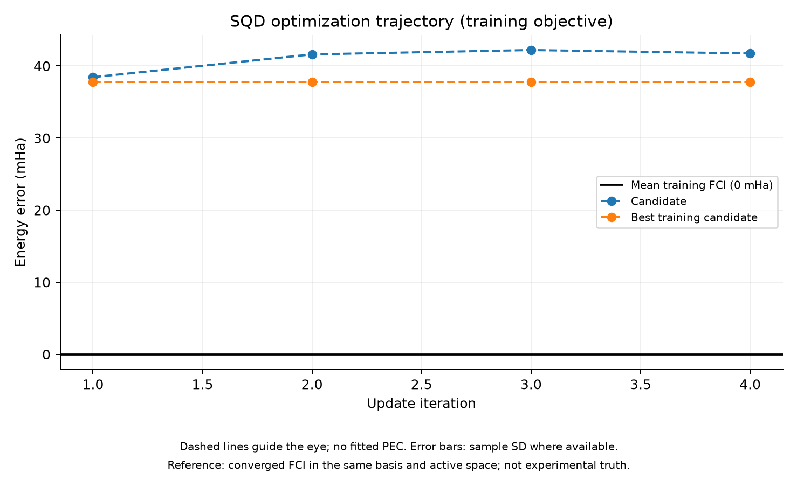
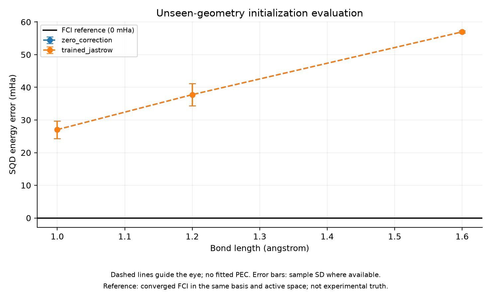
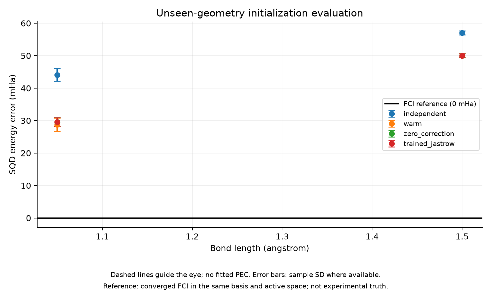
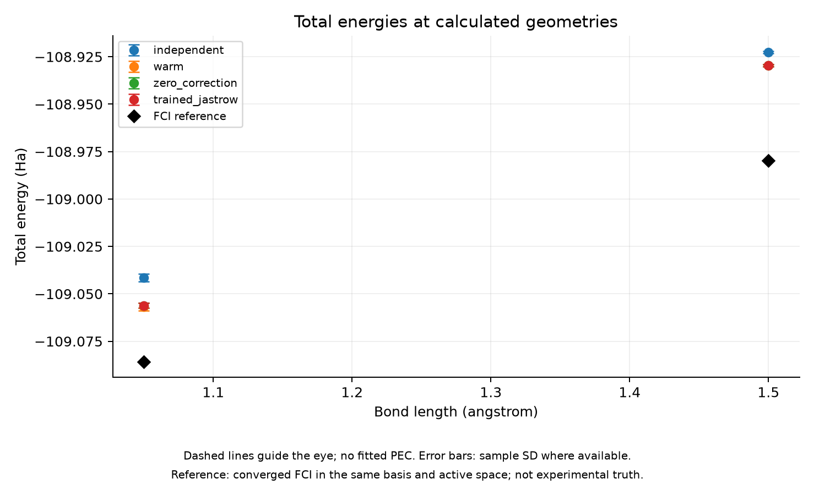

# Direct SQD Joint Learning — Small Jastrow Correction Pilot

실행일: 2026-11-06. **직접 SQD 공동 학습을 실행했지만, 이번 예산에서는 초기 보정 0보다 나은 candidate를 찾지 못했다. 최종 선택 모델은 학습 전 기준과 동일하며 학습 이점은 관측하지 못했다.**

## 방법과 사전 고정 설정

Meta-VQE의 shared physical-objective 학습에서 영감을 얻되, 실제 sampled SQD energy를 평균하는 것은 본 프로젝트의 연구 제안이다. 원 reference가 직접 입증한 SQD meta algorithm은 아니다. Parameter labels에 대한 회귀를 수행하지 않았다.

1.2 Å의 기존 독립 12회 best 하나를 anchor로 사용한다. 내부 orbital rotations와 final rotation은 학습하지 않고 각 geometry에 block-polar로 출력만 전달한다. 허용된 AA 15개/AB 4개 J 계수에 ΔJ(R)=b+s·(R−1.2)/0.4를 더해 총 38개 공유 coefficients를 학습한다. 모든 모델 candidate는 같은 unitary LUCJ family를 유지하며 matrix averaging/polar decode regression을 사용하지 않는다.

Training Hamiltonians는 1.0/1.2/1.6 Å다. 평균 total SQD energy를 목적함수로 쓰며 각 geometry 가중치는 1/3이다. 기존 training FCI는 error reporting에만 쓰고 updates에는 사용하지 않는다. Anchor의 과거 최적화 비용은 별도 기록한다. 다른 geometry의 optimized best는 warm control에만 쓰며 shared J coefficients의 label로 사용하지 않는다.

새 pilot targets는 1.05/1.5 Å로 사전에 고정했다. 이전 분석점 1.1/1.4 Å는 새 평가에 재사용하지 않았다. Final sampling seeds 778899/889900/990011은 candidate 선택에 사용하지 않는다. 모델은 target 계산 전에 frozen으로 기록했다. 모두 50,000 shots 및 기존 SQD batch/solver 조건이다.

## 작은 검증 및 잡음·비용 측정

Zero correction의 state 복원, geometry-linear J correction, matrix 대칭성, fixed orbital rotations 및 norm을 작은 시스템에서 검증했다. 원시 SQD 구현과 frozen reference 조건은 유지했다. 전체 테스트 20개가 통과했다. Plot 생성 시 서로 다른 report의 원시 JSON을 덮어쓰지 않는 검증도 포함했다.

Zero correction을 training 세 구조에서 3개의 독립 sampling seed 묶음으로 평가했다. Aggregate call 평균 시간은 8.84초, 평균 error의 seed 표본 표준편차는 1.60 mHa였다. 사전 시간 예산 120초와 최대 6회 규칙에 따라 4회 갱신을 선택했다. Gains/c/step cap을 결과에 맞추어 바꾸지 않았다. 이 표본 수로 gradient noise covariance나 정확한 SNR을 추정한 것은 아니다.

## 훈련 결과

| 갱신 | Candidate 평균 오차 (mHa) | 선택된 best 평균 오차 (mHa) |
| --- | --- | --- |
| 1 | 38.444 | 37.821 |
| 2 | 41.600 | 37.821 |
| 3 | 42.201 | 37.821 |
| 4 | 41.729 | 37.821 |

초기 fixed-training-seed 평균 오차는 약 37.821 mHa였다. 모든 candidate가 그보다 높아 initial이 선택됐다. Selected coefficient norm은 정확히 0이다. 실제 갱신은 이루어졌고 checkpoint replay error=0으로 계산 경로를 확인했다. Step norms는 약 0.00265/0.01712/0.01753/0.01106으로 cap=0.1은 작동하지 않았다.

이는 4회 noisy SPSA 경로와 이 frozen orbital family의 부정적 pilot 결과다. 모든 shared Jastrow model의 실패나 학습 불가능성, 최적값 도달을 의미하지 않는다. Optimizer status는 budget_exhausted다. Candidate perturbation 효과와 seed 변동이 비슷한 규모인 구간이 있지만, 공분산을 측정하지 않았으므로 잡음을 유일 원인으로 단정하지 않는다.



검은 선은 세 training Hamiltonian FCI 평균에 해당하는 0 mHa다. 이 곡선은 fixed training seed의 empirical objective이며 별도 평가 성능이 아니다.

## 별도 seed의 학습 구조 확인

Zero/selected가 동일하므로 세 구조의 별도 seed 평균도 정확히 같았다. Zero와 selected의 평균 오차는 1.0/1.2/1.6 Å에서 각각 약 27.05/37.76/56.98 mHa였다. Training value의 낮은 수치만으로 성능을 해석하지 않는다.



## 새 geometry 비교

추가 refinement 없는 초기화의 FCI 대비 평균 ± sampling seed 표본 표준편차다.

| 거리 (Å) | Independent (mHa) | Single-hop warm (mHa) | 보정 0 (mHa) | 공동 학습 후 선택 (mHa) |
| --- | --- | --- | --- | --- |
| 1.05 | 44.12 ± 2.03 | 28.79 ± 2.03 | 29.57 ± 1.38 | 29.57 ± 1.38 |
| 1.50 | 57.06 ± 0.61 | 49.99 ± 0.61 | 49.99 ± 0.61 | 49.99 ± 0.61 |

독립 초기화보다 오차가 낮은 것은 anchor 상태의 전달 효과이며 공동 학습의 이득이 아니다. 특히 1.5 Å의 warm source도 동일한 1.2 Å anchor이므로 warm/zero/selected가 같은 상태가 되는 sanity check다. 이번 single-hop 비교는 전체 sequential refinement chain이나 equal-accuracy downstream optimization 비교의 대체가 아니다.





계산 지점이 두 개뿐이므로 곡선을 보간하지 않고 점/오차 막대만 표시했다. FCI는 같은 basis/core/active Hamiltonian의 수치 기준이며 실험값이나 complete-basis limit가 아니다. 두 FCI 모두 수렴했고 residual은 약 1.99e-6/2.19e-6 Ha로 설정 기준을 통과했다.

## 비용과 검증 상태

전체 scientific wall time은 484.49초, process lifetime peak RSS는 5398.66 MiB다. Aggregate noise probes 26.53초, training objective calls 118.09초를 기록했다. 이 aggregate 시간은 내부 single-geometry 평가를 포함하므로 둘을 다시 합산하지 않는다. 새 두 FCI 및 residual 확인은 약 216.51초다.

추가 실험은 총 90 single-geometry SQD evaluations, 540 batch diagonalizations, 4,500,000 shots다. Anchor archive 생성의 과거 end-to-end 비용 140.65초는 이번 wall에 중복 합산하지 않고 별도로 보존한다. 전체 연구 탐색 비용은 이전 report들까지 포함해야 한다.

Run status=success는 state norm/reference/solver residual 검사를 통과했다는 뜻이며 학습 성공을 뜻하지 않는다. 선택 모델이 zero와 동일해 zero control 대비 추가 학습 비용만 들었다. 이 pilot에서 training overhead를 회수하는 이득은 없으며 accuracy-matched speedup이나 quantum advantage를 주장하지 않는다. Figure generation은 scientific timer 밖이다.

## 기록과 다음 판단

원본은 results/jastrow_joint_20261106T013550/report.json이다. Config/source snapshot, model coefficients, current/best/RNG checkpoints, 모든 per-geometry/aggregate evaluations, new integrals 및 reference를 보존했다. 별도 training_evaluation.json/target_evaluation.json과 PNG/SVG/plot-data JSON도 저장했다. 그래프 파일 이름은 report별로 분리해 원시 수치와 서로 덮어쓰지 않는다. 추적 요약은 jastrow_joint_summary.json이다.

다음은 모델을 바로 키우거나 더 많은 test points를 소비하기보다, 한 training geometry에서 J-only 대조 최적화와 perturbation/seed 반복으로 family 내 개선 여지와 update signal을 확인하는 것이다. 그러면 frozen orbital family의 한계, 공유 선형 보정의 한계, 제한된 optimizer/gain/noise 문제를 분리할 수 있다. 이번 1.05/1.5 Å 결과를 모델 수정에 쓰면 development 데이터로 전환하고 다음 최종 평가에는 새로운 geometry를 확보해야 한다.

```bash
PYTHONPATH=src PYTHONDONTWRITEBYTECODE=1 OPENBLAS_NUM_THREADS=1 OMP_NUM_THREADS=1 .venv/bin/python scripts/run_jastrow_joint.py
```

기존 anchor/training reference archives가 필요한 로컬 pilot이며 자동 arbitrary-interruption resume은 아직 없다. Phase 7 전체 benchmark로 진행한 것은 아니다.
