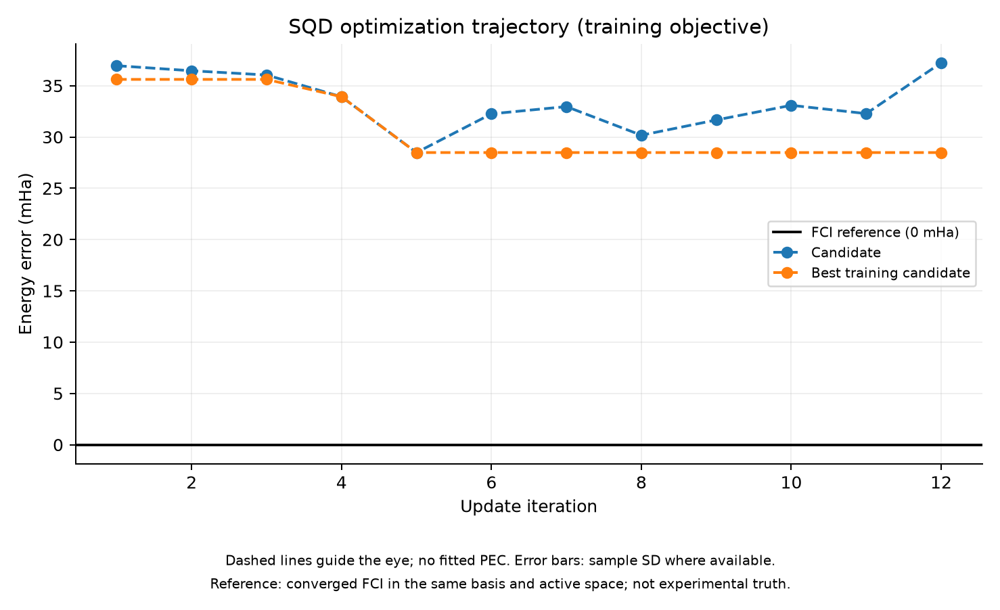
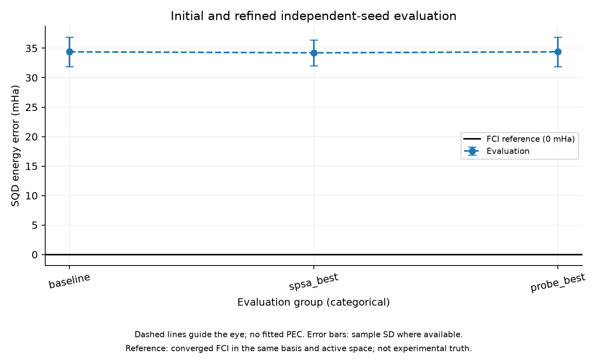
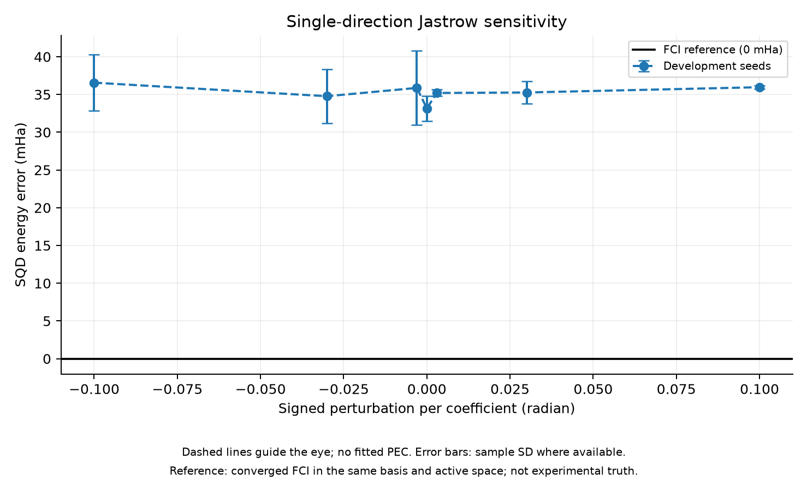

# Single-Geometry Jastrow-Only Control

실행일: 2026-11-06. **1.2 Å에서 J 계수만 조정해 training energy가 낮은 후보를 찾았지만, 별도 sampling seed의 평균 개선은 약 0.17 mHa로 작아 재현 가능한 효과를 확인하지 못했다.**

## 실험 질문과 통제

공동 학습 실패를 frozen orbital family 문제로 바로 설명하지 않고, 같은 anchor 상태에서 local J-only optimization이 실제 개선을 찾는지 확인했다. N₂/6-31G, 1.2 Å, core 2, active (10e,16o), 1-layer LUCJ의 19개 허용 J coefficient만 조정한다. 내부 orbital/final rotations는 고정하고 매 evaluation에서 동일함을 assert했다.

기준은 기존 independent best다. Shared slopes는 사용하지 않는다. Objective는 실제 sampled SQD energy이며 같은 50,000 shots, batch/solver 설정이다. FCI는 같은 Hamiltonian의 저장 적분 일치 검사 후 재사용했다. 추가 FCI 계산은 없었다.

## 두 종류의 탐색

1. 방향 probe: seed 84000으로 고정한 Rademacher direction 한 개에서 amplitude 0, ±0.003, ±0.03, ±0.1 rad/계수를 평가한다. Seeds 84001/84002/84003의 평균으로 diagnostic probe best를 고른다.
2. SPSA: probe 결과로 초기값/gain을 바꾸지 않고 zero에서 시작한다. 기존 a=0.1, c=0.03, schedule, step cap을 유지했다. Call 시간에 따라 120초 update 예산과 최대 12회 규칙을 적용해 12회를 실행했다. Training seed는 공동 실험의 1.2 Å와 같은 71002다.

Final seeds 910101/910102/910103은 두 선택 과정에 쓰지 않았다. 두 실험은 parameter dimension, aggregate objective와 update count가 다르므로 shared/local 차이만 분리한 완전한 factorial 비교는 아니다.

## 결과

| 평가 | 기준 state | SPSA selected | Probe selected |
| --- | --- | --- | --- |
| 새 seed 평균 ± 표본 SD (mHa) | 34.39 ± 2.52 | 34.22 ± 2.17 | 34.39 ± 2.52 |

Fixed training seed에서는 35.613→28.483 mHa로 약 7.13 mHa 감소했다. 하지만 새 seeds에서는 평균 감소가 0.168 mHa에 그쳤고, paired 차이의 표본 SD는 2.487 mHa다. 한 seed는 오히려 악화되고 두 seed는 개선됐다. 세 표본으로 광범위한 통계적 결론을 내리지 않으며, 재현 가능한 개선을 확인했다고 주장하지 않는다.





## Probe 해석

Probe 평균은 amplitude=0에서 가장 낮아 diagnostic probe best도 zero였다. 이 결과는 선택한 한 방향과 반경 안에서의 관측이며 19차원 family의 모든 방향이나 global optimum을 조사한 것이 아니다. SPSA는 다른 방향과 여러 step을 사용해 nonzero 후보를 찾았으므로 두 탐색 결과를 모순으로 해석하지 않는다.



Error bars는 probe seed 표본 SD이며 confidence interval이 아니다. X축은 각 J 계수의 signed directional perturbation이고 geometry/PEC가 아니다. 각 curve의 FCI 0 mHa 선은 같은 finite-basis active Hamiltonian의 수치 reference다.

## 실제 상태 변화

SPSA selected correction norm은 약 0.0414 rad다. Frozen rotations는 그대로 유지됐고 posthoc state comparison에서 baseline과 fidelity 약 0.999519, 확률 TV 약 0.007951을 측정했다. 따라서 update가 무시된 구현이나 같은 state를 반환한 결과가 아니다. 작은 state 차이도 중요한 configuration에 영향을 줄 수 있으므로 fidelity만으로 SQD 성능을 결정하지 않는다.

## 무엇을 알게 됐는가

공동 geometry 학습이 없어도 fixed-seed training gain이 별도 sampling 평가에 유지되지 않는 현상을 관측했다. 따라서 이전 공동 학습 실패를 공유 모델의 표현력만으로 설명할 근거는 부족하다. 고정 sample objective에 대한 적합과 finite-sample variability를 우선 조사할 근거가 생겼다.

다만 noise가 유일 원인인지, gain/budget이 부족한지, 현재 frozen orbital family의 개선 여지가 작은지는 이번 한 경로로 분리하지 못했다. J-only family가 유용하지 않거나 더 큰 모델이 반드시 필요하다는 결론도 정당하지 않다.

## 비용과 검증

Scientific wall time 179.80초, process lifetime peak RSS 1443.56 MiB, 67 objective evaluations, 402 batch diagonalizations, 3,350,000 shots다. 추가 posthoc state comparison 시간은 이 timer에 포함하지 않는다.

State norm, frozen-rotation equality, integral/reference consistency 및 모든 projected residual <1e-6 Ha 검사를 통과했다. 전체 수치 테스트 20개가 통과했다. Run status=success는 실행 검증이며 optimizer는 budget_exhausted다. Probe/final 평가 비용과 기존 anchor 생성 비용도 overall cost 판단에서 구분해야 한다.

원본은 results/jastrow_local_20261106T015732/report.json이다. Source/config snapshot, direction, best/current/RNG checkpoints, sensitivity 및 final evaluation, state_diagnostic.json과 PNG/SVG/수치 JSON을 보존했다. 추적 요약은 jastrow_local_summary.json이다.

## 다음 통제 실험

공동 모델 확대 전에 같은 단일 geometry에서 fixed-seed objective와 여러 training-seed 평균 objective를 **비슷한 총 SQD 호출 예산**으로 비교하는 것이 다음 후보다. Model/rotation family와 최종 독립 seeds를 고정해 sampling 적합 효과를 분리한다. Gain이나 J 범위도 함께 바꾸면 원인 분리가 어려우므로 동시에 변경하지 않는다. 이 후보의 효과는 아직 검증하지 않았다. Phase 7로 진행하지 않는다.

```bash
PYTHONPATH=src PYTHONDONTWRITEBYTECODE=1 OPENBLAS_NUM_THREADS=1 OMP_NUM_THREADS=1 .venv/bin/python scripts/run_jastrow_local.py
```
