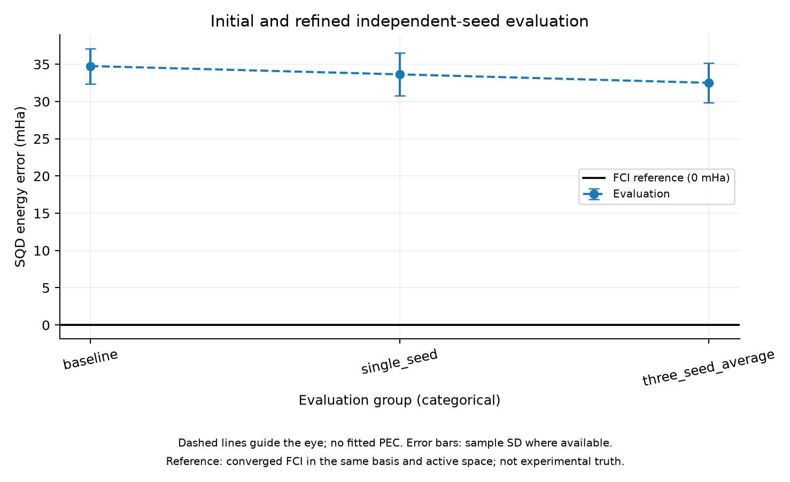
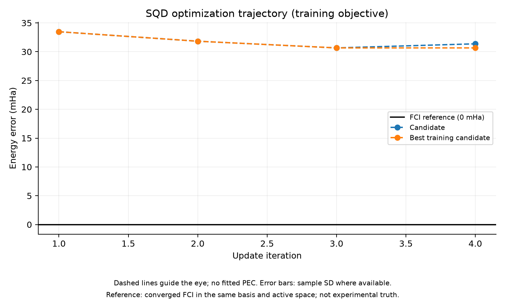

# Jastrow Optimization — Single versus Averaged Training Seeds

실행일: 2026-11-06. **공통 SQD 호출 상한에서 세 seed 평균 학습의 별도 평가 평균 오차가 조금 낮았다. 그러나 차이와 변동성, optimizer 반복 부족 때문에 확실한 우위를 입증한 결과는 아니다.**

## 비교 설계

N₂/6-31G 1.2 Å, core 2, active (10e,16o), 같은 anchor best, frozen orbital rotations, 19개 J 계수, SPSA gains/c/schedule/cap과 50,000 shots를 유지했다. 새로운 probe/gain tuning을 추가하지 않았다.

- Single: training seed 71002, 기존 12회 갱신/37회 SQD calls의 best를 재사용한다.
- Average: training seeds 71002/71012/71022 평균, 4회 갱신/39회 calls로 학습한다.

두 방법 모두 최대 40 calls 이내지만 사용량은 37/39로 정확히 같지는 않다. Averaging이 update당 세 배의 calls를 쓰므로 같은 budget에서 update 수가 줄었다. 이는 같은 예산의 방법 비교이며 seed averaging만 바꾼 동일-update factorial 실험은 아니다. Candidate 수 차이도 selection bias에 영향을 줄 수 있다.

Final seeds 930101–930109의 아홉 개는 두 candidate 선택에 사용하지 않았다. 같은 seeds에서 baseline/single/average를 비교하고 개별 값과 paired difference를 저장했다. 각 방법은 한 optimizer trajectory다.

## 별도 seed 평가 결과

| 방법 | 평균 SQD 오차 ± sampling seed 표본 SD (mHa) |
| --- | --- |
| baseline | 34.76 ± 2.37 |
| single_seed | 33.64 ± 2.88 |
| three_seed_average | 32.51 ± 2.66 |

Baseline 대비 평균 감소는 single 1.11 mHa, average 2.25 mHa였다. 같은 seed의 average 대 single 차이는 평균 1.14 mHa, 표본 SD 4.30 mHa였다. Average가 single보다 낮은 seed는 9개 중 7개였다. 개선되지 않는 seed도 있어 일관된 우위나 통계적 유의성을 단정하지 않는다.



FCI reference는 같은 finite-basis/core/active Hamiltonian의 기준이며 실험값이 아니다. Error bars는 표본 SD이지 confidence interval이 아니다. 이전 3-seed 평가와 현재 9-seed 값이 다른 것은 sampling set이 달라졌기 때문이다. 이전 값을 삭제하거나 유리한 seed만 골라 보고하지 않았다.

## 훈련 과정

Three-seed 평균 objective는 초기 약 34.65 mHa에서 선택된 candidate 약 30.66 mHa로 줄었다. 새 seed 평균은 32.51 mHa다. Single의 training best 28.48 mHa와 숫자만 비교하면 sampling objective가 다르므로 부정확하다. 주 판단은 같은 최종 seed에서의 결과다.



SPSA best coefficient norm은 average 약 0.0375, single 약 0.0414다. Frozen rotations와 unitary state 준비를 유지했다. Optimizer 상태는 budget_exhausted이며 수렴을 주장하지 않는다.

## 비용 및 검증

Single의 기존 training calls 시간 합은 98.63초, average의 이번 training calls 시간 합은 100.40초였다. Component 시간이며 source/archive setup과 별도 평가 비용을 포함한 end-to-end와 구분한다. 신규 실행 전체 scientific wall은 173.51초, process lifetime peak RSS는 1442.84 MiB다.

신규 실행은 average training 39회 + 최종 평가 27회 = 66 SQD calls, 396 batch diagonalizations, 3,300,000 shots다. 기존 single training 37회를 공짜로 간주하지 않고 별도 비용을 보존했다. 전체 연구 비용에는 이전 probe/독립 평가/anchor 생성도 포함해야 한다.

같은 적분과 reference archive의 일치, state norm, 모든 projected residual <1e-6 Ha 검사를 통과했다. FCI를 새로 계산하지 않았다. Run success는 수치적 실행 검증이며 연구 가설의 성공 판정이 아니다. 그래프 생성은 scientific timer 밖이다.

## 해석과 다음 판단

이번 제한된 비교는 여러 training seeds를 사용하는 방향을 검토할 근거지만, noise가 유일한 실패 원인이라는 증명이나 평균 학습의 광범위한 우위는 아니다. Update 수, candidate 수와 training-seed realization이 함께 달라졌다. 충분한 정확도나 비용 이점도 확보하지 못했다.

다음에는 같은 maximum-call protocol에서 optimizer/training seed 묶음을 바꾼 반복으로 결과가 유지되는지 확인하는 것이 우선이다. 그 뒤에 shared geometry 모델로 확대할지 판단한다. 새로운 test geometry에 바로 확대하거나 neural network를 도입할 근거로 삼지 않는다. 여전히 Phase 6의 원인 분리 단계이며 Phase 7 전체 benchmark는 아니다.

원본은 results/jastrow_seed_average_20261106T020635/report.json이다. Config/source snapshot, coefficients/RNG checkpoints, 전체 per-call histories와 개별 평가값을 보존했다. 추적 요약은 jastrow_seed_average_summary.json이다.

```bash
PYTHONPATH=src PYTHONDONTWRITEBYTECODE=1 OPENBLAS_NUM_THREADS=1 OMP_NUM_THREADS=1 .venv/bin/python scripts/compare_jastrow_seeds.py
```
