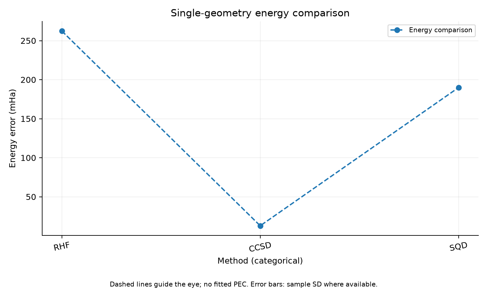

# Phase 1 Results

실행일: 2026-11-03. 상태: 최소 파이프라인 검증 통과, 초기 SQD 정확도 개선 필요. Phase 2 sweep은 시작하지 않았다.

## 설정과 재현

N₂, 1.2 Å, 6-31G, frozen core 2, active (10e,16o), neutral singlet. 단순 CCSD double factorization/locality truncation, spin-balanced 1-layer LUCJ, t₁ final rotation, 531 parameters. 압축 및 SQD 파라미터 최적화는 수행하지 않았다. configs/phase1.json과 DECISIONS.md D008 참조.

```bash
OPENBLAS_NUM_THREADS=1 OMP_NUM_THREADS=1 .venv/bin/python -m pytest -q
PYTHONPATH=src OPENBLAS_NUM_THREADS=1 OMP_NUM_THREADS=1 .venv/bin/python scripts/run_phase1.py --reference
```

주 실행 원본: results/phase1_20261103T064449/report.json. 이 디렉터리에 integrals, MO, CCSD amplitudes, parameters, samples, SQD state와 source snapshot을 보존했다. results는 Git 제외 대상이므로 이 문서가 추적되는 결과 요약이다. 실행은 dirty working tree에서 수행했으며 원본 report에 revision·버전·설정 hash를 기록했다. 테스트 실행 결과는 5 passed, 4 warnings, 0.94초였다. 경고는 PySCF OpenMP 미지원이며 단일 스레드를 사용했다.

## 수치 검증

- H₂/STO-3G, 0.74 Å: HF -1.1167593073964255 Ha, FCI -1.137283834488502 Ha.
- H₂의 MO 직교성, 적분 대칭, HF 복원, ffsim Hamiltonian 전체 행렬과 PySCF FCI 일치, 전체 support SQD와 FCI 일치를 테스트했다.
- LUCJ zero parameter의 HF 복원, 파라미터 round trip의 상태 일치, norm, 고정 seed 샘플 재현을 테스트했다.
- 비대칭 spin sector (2,1), 3 orbital의 HF bitstring이 001011임을 확인했다. Beta-left/alpha-right 및 endian convention의 검증이다.
- 제한된 LUCJ 샘플은 H₂에서도 FCI를 반드시 복원하지 않았다. 별도로 sampled SQD의 variational bound와 projected residual을 검사했다.

## N₂ 결과

| 항목 | 측정값 |
| --- | --- |
| RHF total | -108.83577420992894 Ha |
| CCSD total | -109.0852858564033 Ha |
| FCI total | -109.09813082049689 Ha |
| SQD total | -108.90818025938671 Ha |
| SQD − FCI | +0.18995056111018016 Ha = 189.95056 mHa |
| SCF / CCSD / FCI 수렴 flag | 모두 true |
| FCI eigenvector residual norm | 1.53e-5 Ha |
| SQD projected residual norm | 5.04e-7 Ha |
| HF energy reconstruction error | -8.53e-14 Ha |
| LUCJ norm error | 7.75e-14 |
| Shots / particle-valid shots | 10,000 / 10,000 |
| Unique sampled determinants | 21 |
| Selected subspace dimension | 110 |

전자 배치의 alpha/beta string Cartesian product 때문에 관측 determinant 수와 부분공간 차원은 다르다. 세 batch와 두 callback iteration의 에너지·차원이 모두 같았다. 이는 독립 seed 평가의 대체가 아니다. Recovery loop를 호출했지만 입자수 오류가 없는 ideal samples이므로 noise recovery 효능을 검증한 것은 아니다.

FCI는 설정된 에너지 수렴 기준 1e-9 Ha로 종료했지만 residual은 1.53e-5 Ha다. 이 결과를 모든 표시 자릿수가 정확한 certified reference라고 해석하지 않는다. 현재 약 0.19 Ha의 SQD 오차를 진단하는 데는 충분하지만, 작은 차이의 최종 비교 전 reference 수렴을 강화해야 한다. SQD projected residual이 작아도 전체 공간에 대한 energy error가 작다는 뜻은 아니다.

## 시간과 메모리

| 단계 | Wall time |
| --- | --- |
| Chemistry | 0.025초 |
| CCSD | 0.038초 |
| LUCJ 초기화 | 0.003초 |
| State preparation | 1.097초 |
| Sampling | 0.143초 |
| SQD 및 projected residual 확인 | 0.078초 |
| FCI | 77.771초 |
| FCI residual 확인 | 4.631초 |
| 전체 실행 | 83.842초 |

프로세스 lifetime peak RSS는 5,208.19 MiB, 약 5.09 GiB다. Native allocation을 포함한 process 측정이며 단계별 peak는 아니다. 라이브러리 초기 import는 전체 타이머 밖이다. 원본 실행은 단일 측정이며 별도 H₂ 테스트 실행과 초기 실패/예비 실행은 위 시간에 합산되지 않았다. 성능 비교나 speedup의 근거로 사용하지 않는다.

## 실패 및 제한

초기 실행 results/phase1_20261103T064409는 SCF get_grad 호출 인자 누락으로 실패했다. 호출을 수정하고 실패 report를 보존했다. 다음 예비 실행은 성공했지만 reference 및 residual 검사가 없어 주 결과로 사용하지 않았다. H₂ sampled energy가 exact여야 한다는 잘못된 테스트 가정을 수정한 이유는 DECISIONS.md D009에 기록했다.

CCSD 초기화만 사용했으며 LUCJ parameter refinement, compressed initialization, 최적화 baseline, seed 변동성, noise, alignment, meta learning은 검증하지 않았다. 중간 배열을 저장하지만 각 단계에서 임의 재시작하는 resume 기능은 아직 없다. SCF/CCSD iteration history 및 최종 CCSD equation residual 기록도 후속 개선 대상이다.

## 해석과 다음 작업

최소 chemistry–LUCJ–sampling–SQD 연결과 작은 문제의 수치 검증은 통과했다. 그러나 현재 truncated 1-layer 초기화의 SQD 정확도는 충분하지 않다. 21개의 unique samples는 제한된 sampling support를 보여주지만, 원인이 topology, layer 수, 초기화 또는 shot budget 중 무엇인지는 이번 한 번의 실험으로 분리할 수 없다.

다음에는 같은 1.2 Å에서 compressed initialization과 단순 truncation을 동일 조건으로 비교하고, sampling support와 SQD 에너지를 진단한다. Reference 강화와 seed 변동성을 함께 확인한 후 Phase 2 진행 여부를 판단한다. 개선을 위해 topology·반복 수·예산을 바꾸면 별도 설정과 결정으로 기록한다.

## 그래프



점선은 계산된 점 사이의 시각적 안내이며, 오차 막대는 제공된 seed 간 표본 표준편차입니다. 매끄러운 PEC fitting이나 confidence interval을 의미하지 않습니다.

[SVG](figures/phase1.svg) · [그래프 수치](figures/phase1.json)
