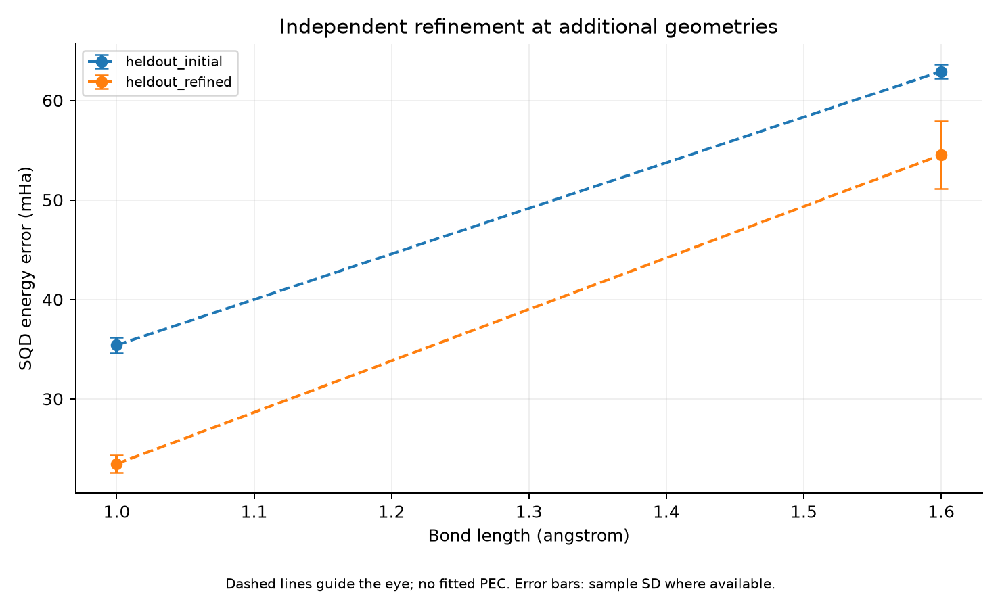

# Phase 3 — Refinement at Additional Bond Lengths

실행일: 2026-11-04. N₂ 1.0/1.6 Å에 고정한 독립 SQD refinement pilot을 적용했다. **두 거리 모두 초기값 대비 별도 sampling 평가에서 개선됐다.** 각 거리는 한 optimizer trajectory이며, optimizer 수렴이나 강한 baseline 확립은 아직 아니다.

## 설정과 비교 범위

configs/phase3_geometries.json을 사용했다. 기존 Phase 3와 같은 6-31G, frozen core 2, active (10e,16o), 1-layer spin-balanced LUCJ, locality 및 final t₁ rotation을 유지했다. 각 geometry의 독립 SCF/CCSD와 λ=0.001 compressed initialization에서 시작한다. 다른 geometry의 최적화 파라미터를 가져오지 않았다.

SPSA 12회 갱신, optimizer seed 45678, training seed 12345, gain/schedule 및 step cap을 고정했다. Objective는 각 50,000 shots와 기존 SQD batch/solver 조건이다. 최종 seeds 89012/90123/101234는 후보 선택에 쓰지 않았고 초기·최종을 같은 seeds에서 평가했다. 같은 seed 번호의 사용을 완전한 통계적 coupling이나 여러 geometry의 독립 restart 증거로 간주하지 않는다.

## 결과

FCI 대비 오차의 평균 ± 표본 표준편차이며, ±는 한 optimizer trajectory에 대한 sampling seed 3개의 변동이다.

| 거리 (Å) | 초기값 오차 (mHa) | Refinement 후 오차 (mHa) | 평균 감소 (mHa) |
| --- | --- | --- | --- |
| 1.0 | 35.41 ± 0.77 | 23.47 ± 0.89 | 11.94 |
| 1.6 | 62.91 ± 0.74 | 54.52 ± 3.39 | 8.39 |

두 geometry의 각 평가 seed에서도 개선됐다. 1.6 Å의 남은 오차가 더 커, 같은 초기화와 최적화 예산의 정확도가 거리에 의존함을 보여준다. 이번 두 점만으로 원인을 강상관, 표현력, 샘플 예산 또는 optimizer 성능 중 하나로 확정하지 않는다.

1.2 Å의 첫 경로를 같은 평가 seeds에서 평가한 이전 기록은 44.56→36.62 mHa다. 이는 비교 문맥으로만 사용하며 이번에 재계산한 결과는 아니다. 1.2 Å에서는 세 optimizer/training 경로를 검증했지만 이번 두 거리에서는 각 한 경로만 계산했으므로 재현성 증거의 수준이 다르다.

## 검증, 비용, 종료 상태

두 실행의 SCF/CCSD 및 압축 초기화는 수렴했다. 모든 평가에서 state norm과 SQD projected residual <1e-6 Ha 검사를 통과했다. Run status=success는 수치 검사를 통과했다는 뜻이고 optimizer_status=budget_exhausted다. 실제 optimizer 수렴을 주장하지 않는다. 수치 테스트 9개도 통과했다.

| 거리 (Å) | Objective 평가 수 | Batch diagonalizations | Child wall time (초) | Process peak RSS (MiB) |
| --- | --- | --- | --- | --- |
| 1.0 | 46 | 276 | 130.61 | 1607.94 |
| 1.6 | 46 | 276 | 147.10 | 1604.77 |

Child wall time 합은 277.72초다. 초기화·noise probes·훈련·별도 평가·기록을 포함하며, parent의 적분 준비·child import 및 orchestration overhead는 제외한다. 단일 스레드로 순차 실행했으며 lifetime peak RSS는 각 child process 기준이다. 기존 FCI reference 생성 비용도 이번 시간에 포함하지 않았다. 같은 정확도까지의 비용 비교가 아니므로 speedup을 주장하지 않는다.

## Reference의 재사용

Phase 2의 각 geometry report에서 FCI convergence와 residual을 검사한 기준값을 재사용했다. Physical configuration과 HF total 일치를 확인하고 같은 chemistry 구현으로 h1/eri/ecore를 재생성했다. Child 실행에서는 그 재생성 archive와 다시 일치 검사를 했다.

Phase 2에서 이 두 geometry의 integral archive를 저장하지 않았으므로, 과거 배열과 직접 비교한 검증이 아니라 동일 설정·HF 에너지 및 구현에 근거한 reference 재구성이다. 이 provenance 제한을 원본 report와 이 문서에 남긴다. 향후 다른 환경의 엄격한 재현을 위해 이번 재생성 archive는 보존한다.

## 기록과 다음 단계

Orchestration report: results/phase3_geometries_20261104T061054/report.json. Point별 config/integrals/execution.log 및 child source snapshot, initial/best/current parameter arrays, trajectory RNG state와 모든 evaluation history를 저장했다. Git 추적 수치는 phase3_geometries_summary.json이다. 원본 실패는 없었다.

세 거리에서 제한된 독립 refinement의 작동을 관측했다. 새 두 거리의 optimizer/training seed 반복과 예산·정확도 관계는 아직 검증하지 않았으므로, 전체 Phase 3 baseline의 충분한 최적화나 Phase 4 준비 완료로 선언하지 않는다. 목표 정확도에도 도달하지 않았다. 다음 판단에는 새 거리의 반복 변동성과 비용 예산을 포함해야 한다.

```bash
PYTHONPATH=src PYTHONDONTWRITEBYTECODE=1 OPENBLAS_NUM_THREADS=1 OMP_NUM_THREADS=1 .venv/bin/python scripts/run_phase3_geometries.py
```

기존 Phase 2 summary와 local reference report가 필요한 재현 명령이다. 자동 resume 기능은 이 orchestration에 아직 없다.

## 그래프



점선은 계산된 점 사이의 시각적 안내이며, 오차 막대는 제공된 seed 간 표본 표준편차입니다. 매끄러운 PEC fitting이나 confidence interval을 의미하지 않습니다.

[SVG](figures/phase3_geometries_summary.svg) · [그래프 수치](figures/phase3_geometries_summary.json)
