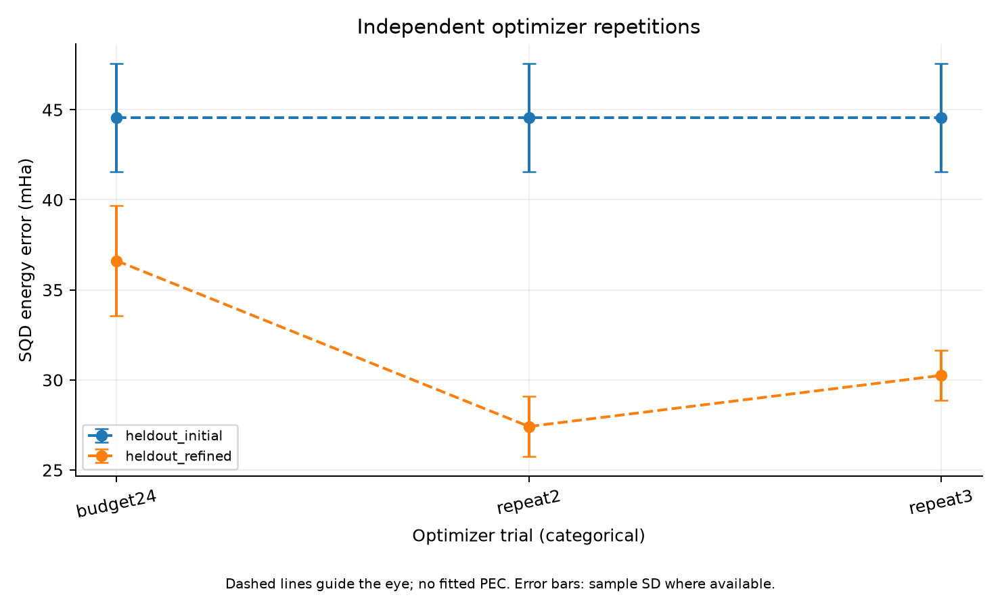

# Phase 3 — Independent Repetitions and Budget Check

실행일: 2026-11-03. N₂ 1.2 Å의 단일 지점에서 optimizer/training randomness를 바꾼 세 경로와 한 경로의 예산 증가를 진단했다. **세 경로 모두 별도 sampling 평가에서 개선됐지만 optimizer 수렴과 목표 정확도는 미입증이다. 전체 Phase 3의 geometry별 baseline 구축은 진행 중이다.**

## 통제 조건

Phase 3 pilot의 chemistry, λ=0.001 초기화, 531 parameters, SPSA gains/step cap, 50,000 shots, batch/solver 조건을 유지했다. 기존 경로(seed 45678, training 12345)를 저장된 current/best/RNG state에서 12→24회로 연장했다. Physics/effective config, gains 및 initial parameter 일치를 검사했다. 추가 두 경로는 optimizer/training seeds 45679/12346, 45680/12347을 사용하고 12회만 실행했다. 두 randomness 요인을 함께 바꿨으므로 효과를 분리하는 실험은 아니다.

새 평가 seeds 89012/90123/101234는 parameter 선택에 사용하지 않았다. Candidate 선택은 각 training energy만 사용했고, 평가 결과로 hyperparameter나 checkpoint를 재선택하지 않았다. 이 모든 geometry와 seeds는 개발 pilot 기록이며 향후 최종 generalization test를 대신하지 않는다.

## 반복 결과

아래 ± 값은 각 경로에 대해 평가 seed 3개의 표본 표준편차다. 같은 초기 파라미터와 평가 seeds를 사용해 initial 결과는 동일하다.

| 경로 | 갱신 예산 | 초기 오차 (mHa) | 추가 최적화 후 오차 (mHa) |
| --- | --- | --- | --- |
| 1 | 12 | 44.56 ± 3.01 | 36.62 ± 3.05 |
| 2 | 12 | 44.56 ± 3.01 | 27.42 ± 1.68 |
| 3 | 12 | 44.56 ± 3.01 | 30.25 ± 1.38 |

경로 1의 12회 값은 연장 실행에서 저장된 이전 best를 같은 새 seed로 재평가한 값이다. 세 경로 평균 오차의 평균은 31.43 mHa, 경로 평균들 사이의 표본 표준편차는 4.71 mHa다. 이는 sampling seed 내부 변동성과 다른 통계다. 공유 평가 seeds 때문에 9개 결과를 완전히 독립된 표본으로 합치지 않았다. 세 경로 및 각 평가 seed에서 개선을 관측했지만 3회로 광범위한 재현성이나 통계적 유의성을 단정하지 않는다.

## 12회 대 24회

경로 1을 24회로 연장해도 training objective가 더 좋은 candidate를 찾지 못했다. Best parameters가 그대로여서 새 seed의 평균 오차는 12회와 24회 모두 36.62 ± 3.05 mHa였다. 이 경로에서는 추가 예산 이득이 없었다. 나머지 경로의 24회 결과는 계산하지 않았으므로 전체 optimizer에 대해 12회가 최적 예산이라고 결론 내리지 않는다.

## 검증과 비용

새 실행 세 개 모두 실행 검사를 통과했고 모든 기록된 SQD batch projected residual이 1e-6 Ha 아래였다. 초기 norm, reference integral 일치 및 compression 수렴을 검사했다. 모든 optimizer_status는 budget_exhausted이며 success run 상태는 수렴을 의미하지 않는다.

| 실행 | 이번 실행 시간 (초) | 이번 목적함수 평가 수 |
| --- | --- | --- |
| budget24 | 154.97 | 49 |
| repeat2 | 140.23 | 46 |
| repeat3 | 157.02 | 46 |

신규 child run wall time 합계는 452.22초다. 경로 1의 선행 pilot 140.65초는 별도이며, 두 값을 합하면 592.87초다. 이 합계에는 초기화, noise probes, training, 별도 평가와 기록이 포함되며 child 초기 import 및 orchestration overhead는 제외한다. 같은 reference FCI를 재사용했고 최초 reference 생성 비용은 기존 기록에 있다.

선행 pilot을 포함한 실제 목적함수 평가 수는 187회다. 연장 실행은 초기 noise probe/initial consistency 평가를 반복했고 12회 checkpoint와 24회 checkpoint를 각각 평가했으므로, 중복 진단 평가까지 숨기지 않고 비용에 포함했다. 순수 SPSA training 예산은 12회에서 37회, 24회에서 73회지만 재개 시 실제 initial 평가가 한 번 추가된다. 최대 process lifetime peak RSS는 1605.00 MiB다. 실행들은 순차 수행했다.

## 기록과 다음 단계

Orchestration report: results/phase3_repetitions_20261103T074655/report.json. 각 child report, parameter checkpoint, RNG state, batch histories, 설정과 source snapshot을 보존했다. Git 추적 요약은 phase3_repetitions_summary.json이다. 수치 테스트 9개가 통과했다.

단일 지점에서의 첫 개선이 다른 optimizer/training seeds에서도 반복 관측됐다. 다음은 이 고정 12회 pilot 설정을 다른 소수 geometry에 적용해 독립 refinement baseline의 거리 의존성을 확인하는 것이다. 아직 전체 독립 baseline의 충분한 최적화, 정확도 목표 도달, warm-start 이점 또는 Meta 비용 절감을 입증하지 않았다. Phase 4로 넘어가지 않는다.

```bash
PYTHONPATH=src PYTHONDONTWRITEBYTECODE=1 OPENBLAS_NUM_THREADS=1 OMP_NUM_THREADS=1 .venv/bin/python scripts/repeat_phase3.py
```

기존 pilot checkpoint와 reference archives가 필요한 로컬 재현 명령이다. Resume은 이번 12→24회 경로에서 실행 검증했으나 임의 중단 지점이나 변경된 library 버전에서 일반적으로 검증된 것은 아니다.

## 그래프



점선은 계산된 점 사이의 시각적 안내이며, 오차 막대는 제공된 seed 간 표본 표준편차입니다. 매끄러운 PEC fitting이나 confidence interval을 의미하지 않습니다.

[SVG](figures/phase3_repetitions_summary.svg) · [그래프 수치](figures/phase3_repetitions_summary.json)
