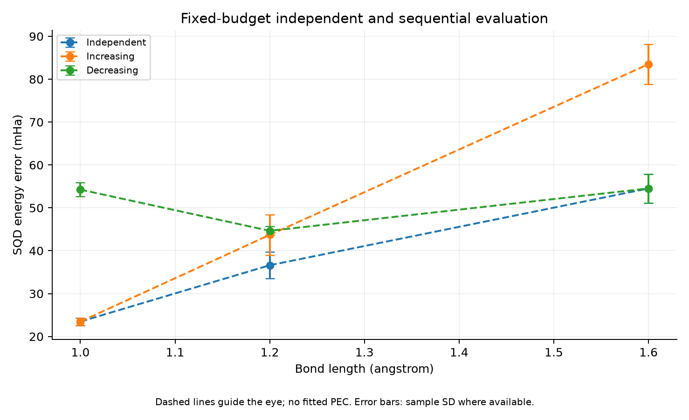

# Phase 4 — Fixed-Budget Sequential Warm-Start Pilot

실행일: 2026-11-04. **증가·감소 방향 pilot을 모두 실행했다. 이번 sign-only 전송은 독립 최적화보다 높은 오차를 보였고, warm-start 이점을 입증하지 못했다. Meta 모델은 사용하지 않았다.**

## 목적과 고정 예산

사용자가 현재 수십 mHa 오차를 workflow pilot에서 허용하기로 결정함에 따라 fixed-budget baseline 비교로 진행했다. 목표 정확도 달성이나 optimizer 수렴을 전제로 하지 않는다. N₂/6-31G, frozen core 2, active (10e,16o), 같은 1-layer ansatz, SPSA 12회, 50,000 shots, training/direction seeds 12345/45678, evaluation seeds 89012/90123/101234를 유지했다. Candidate 선택은 training energy만 사용했다.

거리 순서는 1.0→1.2→1.6 Å 및 1.6→1.2→1.0 Å다. 각 chain 첫 점은 기존 independent best를 재사용하고, 그 생성 비용도 누적 비용에 포함한다. Target에서는 CCSD 압축 초기화를 새로 만들지 않고 source best를 전달한다. 각 target에는 같은 수의 SQD refinement objective 평가를 부여했다.

## 전송 convention 및 테스트

Cross-geometry active MO overlap의 대각 부호로 D를 정한다. J는 유지하고 orbital rotations 및 final rotation을 DUD로 변환한다. Closed-shell HF에서 두 spin의 위상이 상쇄되어 변환 상태는 Γ(D) 원래 상태다. Nontrivial random LUCJ의 H₂ state 및 함께 gauge 변환한 Hamiltonian energy 일치 테스트를 추가했다. 전체 테스트 10개가 통과했다.

Permutation, degenerate-subspace rotation 또는 Procrustes 정렬은 하지 않았다. 같은 index를 대응시키는 sign-only baseline이며 전체 gauge 분석을 완료한 방법이 아니다. 이는 고정 topology를 유지하며 사전 정한 전달 규칙의 진단이다. 실제 서로 다른 Hamiltonian 간 에너지 보존은 요구하지 않는다.

## 결과

평가는 같은 신규 sampling seeds 3개의 평균 ± 표본 표준편차다. 1.2 Å 독립 값은 기존 12회 checkpoint의 신규 seed 재평가 기록이며, 최초 pilot의 다른 seed 평균과 혼동하지 않는다.

| 거리 (Å) | 독립 최적화 (mHa) | 증가 방향 (mHa) | 감소 방향 (mHa) |
| --- | --- | --- | --- |
| 1.0 | 23.47 ± 0.89 | 독립 첫 점 재사용 | 54.25 ± 1.62 |
| 1.2 | 36.62 ± 3.05 | 43.70 ± 4.70 | 44.64 ± 1.02 |
| 1.6 | 54.52 ± 3.39 | 83.50 ± 4.67 | 독립 첫 점 재사용 |

네 target의 평균 오차는 모두 해당 independent 결과보다 컸다. 이번 규칙과 예산의 부정적 결과이며, 모든 warm start가 나쁘다는 결론은 아니다. 각 방향은 하나의 optimizer trajectory뿐이며 sampling seed 변동과 optimizer 반복 변동은 구분해야 한다. Refined가 transferred initial보다 좋아지는 것과 independent보다 좋아지는 것은 다른 질문이다.

## 오비탈 대응 한계

| 전달 구간 (Å) | 최소 절대 대각 overlap | 최대 절대 off-diagonal overlap |
| --- | --- | --- |
| 1.0→1.2 | 1.12e-16 | 0.934 |
| 1.2→1.6 | 0.18 | 0.858 |
| 1.6→1.2 | 0.18 | 0.858 |
| 1.2→1.0 | 1.12e-16 | 0.934 |

일부 index overlap이 거의 0이고 다른 index와 큰 overlap을 보여 부호만의 정렬이 불충분함을 확인했다. 축퇴 orbital rotation과 ordering 변화가 가능한 원인이지만 이번 결과만으로 성능 차이의 유일한 원인을 확정하지 않는다. 다음 Phase 5에서 이 표현 문제를 먼저 분석해야 한다. 그 전에는 이 pilot을 강한 warm-start baseline으로 간주하거나 Meta 모델과의 최종 비교에 사용하지 않는다.

## 비용 및 검증

- 증가 방향: 기존 endpoint 130.61초 + 두 target 실행을 포함한 child wall time 합 392.82초.
- 감소 방향: 기존 endpoint 147.10초 + 두 target 실행을 포함한 child wall time 합 378.73초.

새 warm target 4개의 orchestration wall time은 497.60초다. Endpoint를 공짜로 계산하지 않았으며 누적 chain 비용과 신규 실제 소요시간을 구분한다. Child 시간은 import 밖 timer이며 orchestration 시간은 import·config/log 작업을 포함한다. FCI reference 비용은 이전 보고서에 별도 기록되어 있다. 모든 방법이 동일 정확도에 도달한 비교가 아니고 단일 timing이므로 speedup을 주장하지 않는다.

각 warm target은 probe 3 + training 37 + 별도 평가 6 = 46 objective evaluations다. 네 target 총 184 evaluations, 9,200,000 shots이며 batch diagonalization 수는 원본에 기록했다. Norm/reference integral consistency 및 모든 SQD projected residual <1e-6 Ha 검사를 통과했다. 모든 optimizer_status는 budget_exhausted다. Run success는 수렴을 뜻하지 않는다.

Source geometry chemistry 재구성도 초기화 시간에 포함된다. 이후 source에는 저장된 MO coefficients를 사용한다. 과거 endpoint는 저장 MO가 없어 동일한 환경에서 재구성했다는 재현성 한계가 있다. Target 적분과 reference archive 일치 검사는 유지했다. 독립 실행의 이전 비용과 이번 warm 실행의 component timer 경계가 완전히 같지 않아 end-to-end 기록을 우선하며 작은 timing 차이를 해석하지 않는다.

## 기록과 다음 단계

Orchestration 원본: results/phase4_20261104T062627/report.json. Point configs/logs, source snapshot, transferred initial/best/current parameters, MO coefficients, RNG state, objective history와 overlap 진단을 보존했다. Git 추적 수치는 phase4_summary.json이다. 실패 또는 미수렴 solver target은 없었다.

Phase 4의 fixed-budget sign-only pilot은 완료했다. 다음은 Phase 5에서 orbital correspondence, degenerate subspaces, parameter gauge 및 상태/분포 유사성을 조사하는 것이다. 정렬을 변경하면 물리적 불변성이나 상태 전송의 의미를 검증하고 warm-start 비교를 다시 해야 한다. Meta 학습과 최종 benchmark는 아직 수행하지 않는다.

```bash
PYTHONPATH=src PYTHONDONTWRITEBYTECODE=1 OPENBLAS_NUM_THREADS=1 OMP_NUM_THREADS=1 .venv/bin/python scripts/run_phase4.py
```

기존 independent checkpoints와 local reference archives가 필요한 재현 명령이다. Arbitrary interruption 자동 resume은 아직 지원하지 않는다.

## 그래프



점선은 계산된 점 사이의 시각적 안내이며, 오차 막대는 제공된 seed 간 표본 표준편차입니다. 매끄러운 PEC fitting이나 confidence interval을 의미하지 않습니다.

[SVG](figures/phase4_summary.svg) · [그래프 수치](figures/phase4_summary.json)
