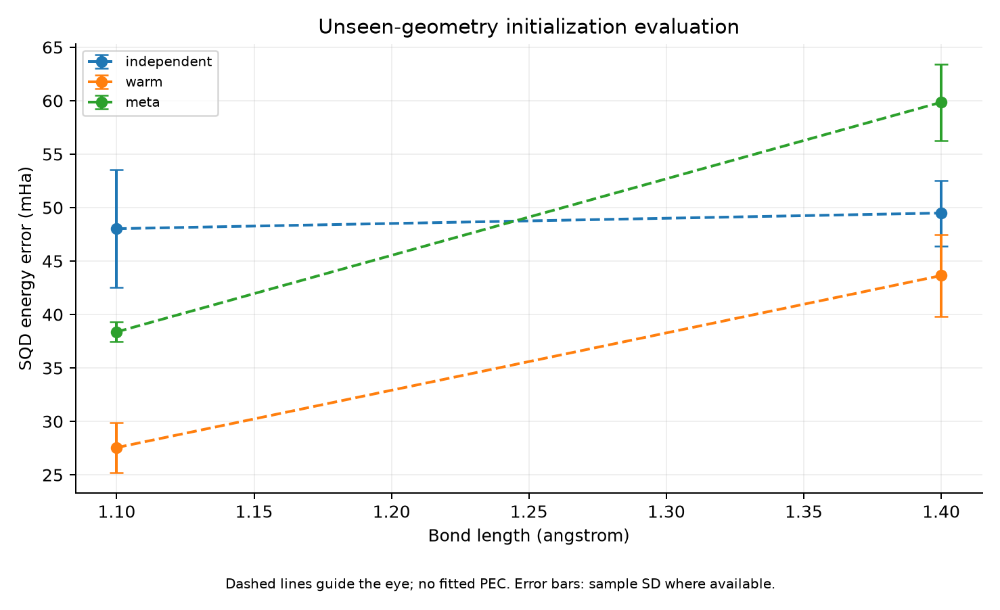
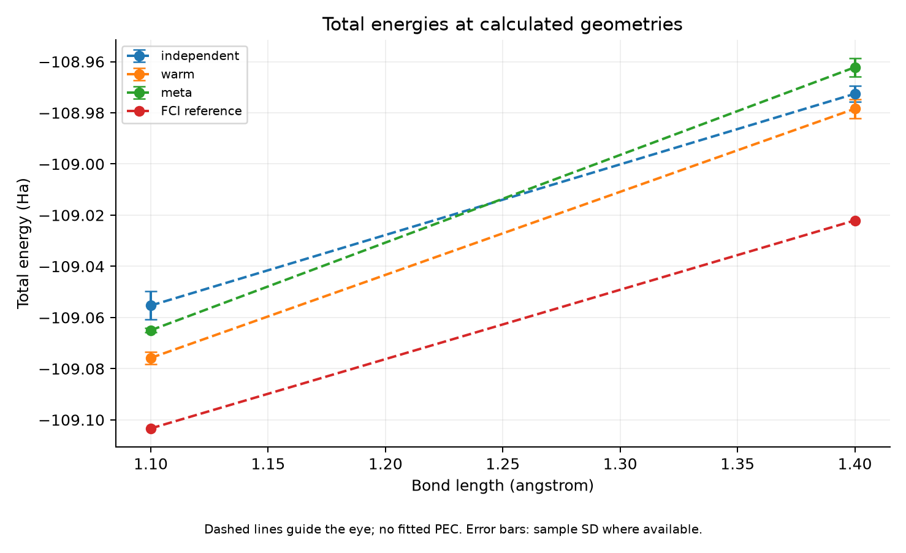

# Phase 6 — First Geometry-Conditioned Meta-LUCJ Pilot

실행일: 2026-11-04. **처음으로 geometry-conditioned 모델을 학습하고 미학습 구조에서 평가했다. 구현은 실행됐지만 이 affine 모델의 일관된 SQD 이점이나 전체 비용 절감은 입증하지 못했다.**

## 학습과 분리

Training geometries는 1.0/1.2/1.6 Å의 기존 독립 fixed-budget best다. Phase 5의 1.2 Å anchor common-frame features 1062개를 사용했다. Model은 y(R)=b+w·((R−mean_train)/std_train)의 affine ridge이며 slope penalty=1e-6, intercept는 무벌점이다. Center/scale과 모든 coefficients는 training arrays에서만 추정했다.

1.1 Å는 validation, 1.4 Å는 pilot test로 사전에 정했다. 이 두 geometry는 training labels에 없고 기존 학습 파라미터를 생성한 지점과 겹치지 않는다. Validation 결과를 보고 model/gain/ridge를 바꾸지 않고 같은 frozen model로 두 point를 평가했다. 이 두 점을 추후 모델 선택에 사용하면 더 이상 최종 독립 test로 주장할 수 없고 새 test가 필요하다.

각 prediction은 common feature를 decode하고 anchor→target block-frame으로 변환한다. Target HF orbitals를 사용하는 chemistry preprocessing은 필요하지만 target CCSD나 target optimized parameters는 Meta prediction에 사용하지 않는다. Target CCSD는 independent control을 위해 별도로 계산했다. 이 supervised parameter/feature regression은 에너지 공유 학습을 하는 원래 Meta-VQE를 재현한 것이 아니라 본 연구의 간단한 geometry-conditioned initialization 제안이다.

## 비교 조건

- Independent: target의 CCSD 및 λ=0.001 regularized compression 초기화.
- Warm: 사전 지정한 training source best 1.0→1.1, 1.2→1.4 Å의 single-hop block-polar 전달.
- Meta: affine common-frame prediction.

모두 추가 refinement 없이 50,000 shots, seeds 112233/223344/334455, 같은 SQD batch/solver 조건으로 평가했다. Single-hop warm은 Phase 4 전체 sequential refinement chain의 대체가 아니다. Target 방문 순서나 최종 결과로 source를 선택하지 않았다.

## 미학습 geometry의 SQD 오차

FCI 대비 sampling seed 3개 평균 ± 표본 표준편차다.

| 거리/역할 | Independent (mHa) | Warm (mHa) | Meta (mHa) |
| --- | --- | --- | --- |
| 1.1 Å / validation | 48.03 ± 5.50 | 27.55 ± 2.34 | 38.37 ± 0.91 |
| 1.4 Å / pilot_test | 49.49 ± 3.07 | 43.64 ± 3.80 | 59.85 ± 3.56 |

1.1 Å에서 Meta는 independent보다 평균 오차가 낮았지만 warm보다 높았다. 1.4 Å에서는 두 control보다 평균 오차가 높았다. 따라서 이 고정 affine 모델의 일관된 이점은 확인하지 못했다. 두 geometry와 세 sampling seeds만으로 일반화 능력이나 통계적 우위를 넓게 주장하지 않는다. 절대 오차도 여전히 수십 mHa다.

## 정확성 검증과 reference

두 target의 SCF/CCSD 및 압축 초기화가 수렴했다. 모든 state norm과 18개 method/seed 실행의 SQD projected residual <1e-6 Ha 검사를 통과했다. 새 FCI는 tol=1e-11 Ha, max_cycle=100이며 두 point 모두 converged이고 residual <1e-5 Ha였다.

| 거리 | FCI total (Ha) | FCI residual (Ha) |
| --- | --- | --- |
| 1.1 Å | -109.10336546390 | 1.54e-06 |
| 1.4 Å | -109.02206084987 | 1.37e-06 |

Known affine function의 예측 수치 테스트를 추가해 전체 테스트 15개가 통과했다. Feature encode/decode 및 common-frame 검증은 선행 Phase 5에서 수행했다. Training feature fit residual은 0이 아니며 이는 수치 오류와 동일하지 않다. 3점의 일반적인 비선형 features를 2개 계수의 affine 함수로 정확히 fit한다고 가정하지 않았다. Feature RMSE를 최종 물리적 성공 지표로 사용하지 않는다.

## 비용과 overhead

- Model fitting: 0.000927초.
- 기존 training label archives의 end-to-end 실행 시간 합: 418.37초.
- Feature archive 준비 기록: 10.21초. 이 값에는 수치 roundtrip 진단도 포함된다.
- 이번 전체 실행: 235.84초, process lifetime peak RSS 5386.11 MiB.

| 거리 | Meta predict/decode/transport | Independent CCSD/압축 초기화 | Warm transfer |
| --- | --- | --- | --- |
| 1.1 Å | 0.000703초 | 1.795초 | 0.000315초 |
| 1.4 Å | 0.000782초 | 1.476초 | 0.000274초 |

위 Meta component에는 target HF 계산과 state preparation/sampling/SQD가 포함되지 않는다. Target HF 준비는 모든 방법에 공유했고 전체 wall에는 포함된다. 전체 실행에는 두 새 FCI reference도 포함돼 대부분 시간을 차지했다. 원본 report에 state preparation과 각 sampling/SQD 시간도 분리 기록했다.

Training label archive 비용은 label 생성뿐 아니라 probe와 독립 평가를 포함한 보수적인 기존 실행 비용이다. 이를 최소 필수 training 비용과 동일시하지 않는다. Development method 탐색·실패·반복 실험의 모든 비용까지 포함한 총 연구 비용은 이 수치보다 크며, 관련 과거 report에 보존되어 있다. Warm도 source best 생성이 필요하고 source pool을 어떻게 공유하는지에 따라 overhead가 다르다.

모델 prediction이 빠르다는 사실만으로 비용 이점을 주장하지 않는다. 정확도가 control과 동일하지 않고 학습 overhead도 있으므로 break-even이나 accuracy-matched speedup은 계산하지 않았다. 전체 optimization 비교에는 같은 refinement budget과 정지 조건의 추가 실험이 필요하다.

## 기록과 해석

원본은 results/phase6_20261104T070714/report.json이다. Config/source snapshot, model coefficients와 train scaling, 각 method parameter arrays, 새 integral/MO archives와 모든 SQD history를 저장했다. Git 추적 수치는 phase6_summary.json이다. 실행 실패나 baseline 압축 미수렴을 제외한 결과가 아니다.

이 실험은 geometry-conditioned inference가 파이프라인에 연결됨을 확인했다. 하지만 affine feature regression이 충분히 좋은 초기화를 예측한다는 가설은 지지하기에 부족하다. 원인은 표본 부족, 비선형성, 남은 gauge, decode projection 또는 label 품질 등일 수 있으며 이번 두 점으로 분리하지 못한다.

다음에는 hyperparameter를 test 결과에 맞추기보다 training reconstruction과 상태/샘플 분포 진단으로 원인을 구분해야 한다. 모델을 변경하면 validation/test 분리를 다시 명시하고 최종 평가는 새로운 geometry에 남겨둔다. 신경망이나 더 큰 sweep으로 바로 확대하지 않는다. Phase 7 전체 benchmark는 아직 아니다.

```bash
PYTHONPATH=src PYTHONDONTWRITEBYTECODE=1 OPENBLAS_NUM_THREADS=1 OMP_NUM_THREADS=1 .venv/bin/python scripts/run_phase6.py
```

기존 representation/independent archives가 필요한 로컬 재현 명령이다.

## 그래프



점선은 계산된 점 사이의 시각적 안내이며, 오차 막대는 제공된 seed 간 표본 표준편차입니다. 매끄러운 PEC fitting이나 confidence interval을 의미하지 않습니다.

[SVG](figures/phase6_summary.svg) · [그래프 수치](figures/phase6_summary.json)


