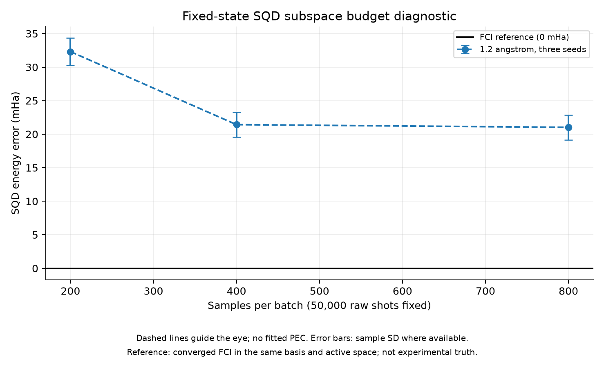

# 고정 상태 SQD 부분공간 예산 진단

1.2 Å의 기존 Phase 3 anchor 상태를 그대로 사용했다. Seed 950101–950103마다 raw shots 50,000개를 한 번 생성하고 동일 배열을 세 예산에 재사용했다. Samples per batch만 200/400/800으로 바꾸고 batches=3, iterations=2, solver tolerance=1e-13을 유지했다. 이는 기존 benchmark를 대체하는 결과나 Meta 학습 성과가 아니다.

| Samples/batch | FCI 대비 평균 오차 ± sample SD (mHa) | 실제 Cartesian 차원 범위 | 평균 SQD 시간 (초) |
| --- | --- | --- | --- |
| 200 | 32.308 ± 2.049 | 10,296–11,124 | 0.989 |
| 400 | 21.422 ± 1.831 | 22,484–23,360 | 1.716 |
| 800 | 21.017 ± 1.858 | 24,450–24,800 | 1.889 |

FCI 기준은 같은 Hamiltonian의 -109.09813082054681 Ha이며 residual=2.99e-6이다. 모든 SQD projected residual은 1.79e-7 미만이다. 이 residual은 선택 부분공간 안의 수렴 검사이며 전체 FCI 에너지 정확도를 보장하지 않는다. 신규 실행 전체 시간은 15.68초이며 기존 anchor 준비 및 FCI 계산 비용은 포함하지 않는다. 세 설정 × 세 seed의 SQD 호출을 사용했다. 이 진단에서는 peak memory를 측정하지 않았다.

200→800에서 평균 11.291 mHa가 줄었다. 반면 400→800 개선은 0.405 mHa다. 서로 다른 raw bitstring은 seed별 497/502/502개였고, alpha/beta 고유 문자열의 Cartesian 곱은 각각 24,450/24,800/24,480이다. 800 설정의 실제 차원과 정확히 일치하므로 해당 raw sample이 제공하는 spin-string 부분공간을 모두 사용했다. 원래 상태가 더 넓은 support를 갖지 않는다는 뜻은 아니다. 같은 raw sample 안에서 batch만 더 키우는 접근은 여기서 포화된다.

`max_dim=250000`은 라이브러리에서 **각 spin sector**에 적용되며 전체 차원의 상한은 그 제곱이다. 최초 D049의 자원 보호 표현은 지나치게 강했다. 이번에는 관측 support가 훨씬 작아 이 값은 결과에 영향을 주지 않았다. 향후에는 sector 상한과 Cartesian 차원을 함께 제한해야 한다.

다음 우선순위는 seed 평균 반복보다 빠진 중요한 전자 배치를 확보하는 방법의 소규모 검증이다. Hamiltonian 연결/잔차를 이용하는 selected-CI 확장은 후보이지만 현재 실행한 SQD와 다른 고전 후처리를 추가하므로 별도 방법으로 기록하고 비용을 계상해야 한다. 먼저 같은 후처리 예산의 모든 초기화 baseline에 적용해야 하며 Meta의 장점으로 계산하지 않는다. 한 거리·한 상태·세 seed만으로 전체 PEC에 일반화하지 않는다.

[SVG](figures/subspace_diagnostic.svg) · [그래프 수치](figures/subspace_diagnostic.json) · [요약](subspace_diagnostic_summary.json)

재현: `PYTHONDONTWRITEBYTECODE=1 PYTHONPATH=src OPENBLAS_NUM_THREADS=1 OMP_NUM_THREADS=1 .venv/bin/python scripts/diagnose_subspace.py`.
원본: `results/subspace_diagnostic_20261106T021528/report.json`, config: `configs/subspace_diagnostic.json`. 후처리 support 집계와 평균은 실행 종료 후 저장 배열에서 산출했으며 report에 명시했다.
